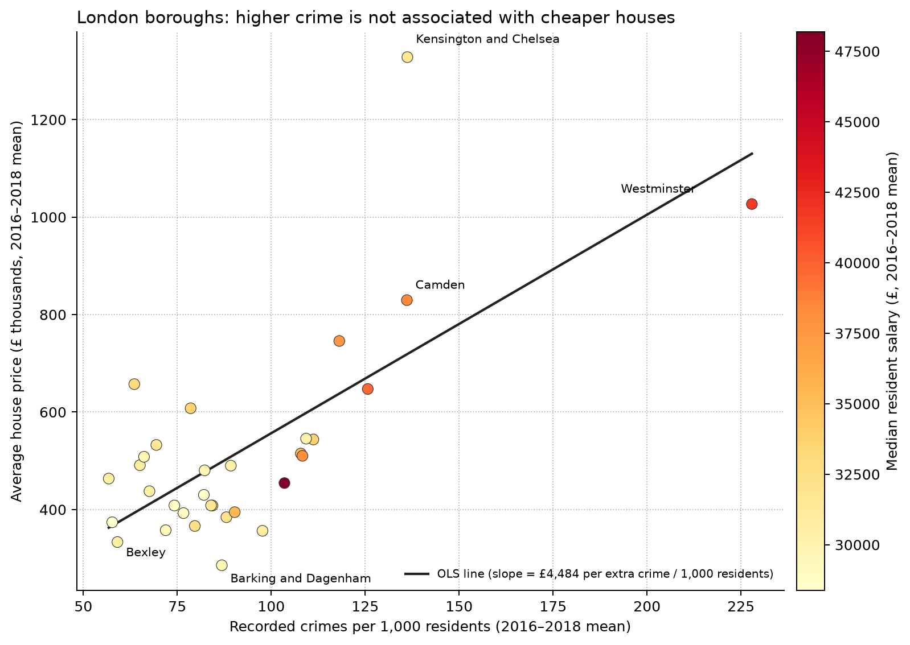
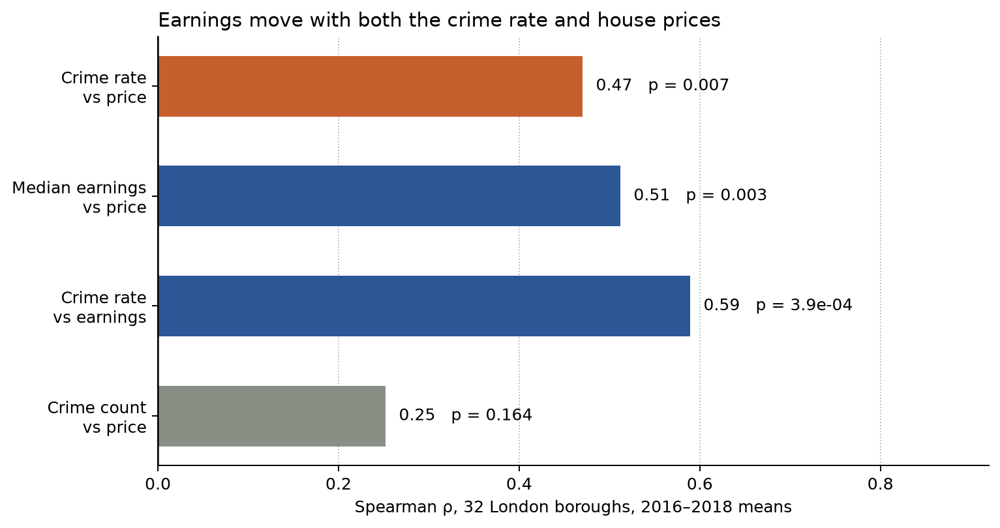

# FANZIQIAN — Data Science Portfolio

Ziqian Fan · FANZIQIAN · MC63582 · CISC7204 Class A

The published page is [https://deoxysd.github.io/data-science-portfolio/](https://deoxysd.github.io/data-science-portfolio/). This file is the same portfolio in Markdown.

## About me

I am learning to turn a research question into a reproducible analysis and a chart that states its own units. The semester project tests a claim about crime and house prices in London boroughs.

## Technical skills

- Python, pandas, and NumPy
- Rank correlation, including a partial Spearman correlation
- Matplotlib
- Jupyter notebooks and GitHub documentation

## Featured project: Crime and house prices in London boroughs

### Research question

In London, do boroughs with a higher recorded crime rate have lower average house prices?

### Approach

I joined the monthly Housing in London table with yearly population and earnings. A borough-year enters only when crime is recorded for at least 10 months. The rate is crimes divided by population, times 1,000. The points are 2016–2018 means for 32 boroughs. The City of London is left out.

### Visualizations

Borough means, 2016–2018. Colour is median earnings. The line is a guide, not a forecast.

The same 32 boroughs. The green bar is the crime–price correlation after earnings are removed (ρ = 0.24). It has no Spearman p-value because it is a partial correlation.

### Findings

The claim does not hold on this cross-section. Spearman’s ρ between the crime rate and average price is 0.47 (n = 32). The association is positive. Median earnings move with prices (ρ = 0.51) and with the crime rate (ρ = 0.59). The raw crime count only reaches ρ = 0.25. After earnings are partialled out of the ranks, the crime–price correlation falls to 0.24.

### Limitation

The result describes 32 boroughs in 2016–2018. It does not show that crime causes high prices, and it does not describe a street or a household. Earnings sit on both sides of the scatter, so the positive ρ is not a clean measure of crime.

### Project repository

[View the code and README](https://github.com/DeoxysD/cisc7204-london-boroughs)

### Status

Ongoing. The 2016–2018 cross-section is in the repository. The team report is not finished.

## Coursework

### Assignment 01 — Data analysis with Python

FANZIQIAN · MC63582

[DeoxysD/CISC7204-Assignment01-PAIR](https://github.com/DeoxysD/CISC7204-Assignment01-PAIR)

Twelve notebooks follow one pipeline: import, clean, explore, model, and evaluate. Module 06 repeats that pipeline on insurance costs and on King County house prices. Write-up: [Readme.md](https://github.com/DeoxysD/CISC7204-Assignment01-PAIR/blob/main/Readme.md).

### Assignment 02 — Data visualization with Python

FANZIQIAN · MC63582

[DeoxysD/CISC7204-MC63582-2026GitHub](https://github.com/DeoxysD/CISC7204-MC63582-2026GitHub)

The labs and the final Dash project are in [cisc7204-Assgn02-2026-MC63582](https://github.com/DeoxysD/CISC7204-MC63582-2026GitHub/tree/main/cisc7204-Assgn02-2026-MC63582).

## Earlier project

[Predicting smartphone addiction](https://github.com/DeoxysD/data-science-project) uses a Kaggle competition as the case (Playground Series S6E8). The final ranking was in the top 15%. The training table is not in that repository. It stays on Kaggle under the competition rules.
